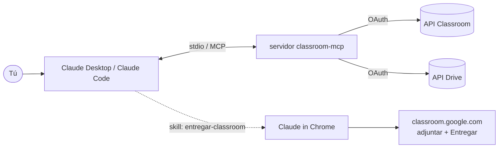

# classroom-mcp

*Read in English: [README.md](README.md)*

Servidor [MCP](https://modelcontextprotocol.io) para usar **Google Classroom como alumno** desde Claude: lista cursos, tareas, materiales y anuncios, descarga adjuntos de Drive y prepara entregas. Incluye una **skill de Claude Code** que completa la entrega en tu navegador, siempre pidiéndote confirmación.

> **Demo:** _pendiente — añade aquí una captura o GIF (p. ej. `docs/demo.gif`)._

## Herramientas

`listar_cursos`, `listar_tareas`, `mis_entregas`, `listar_materiales`, `listar_temas`, `listar_anuncios`, `descargar_archivo`, `preparar_entrega`.

## Arquitectura



## Por qué las entregas pasan por el navegador

La API de Classroom solo permite `modifyAttachments` y `turnIn` sobre tareas **creadas por el mismo proyecto de Google Cloud** que hace la llamada. Las tareas del profesor no son de tu proyecto, así que la API las rechaza. `preparar_entrega` sube el archivo a tu Drive y el último paso (adjuntar y **Entregar**) se hace en la web de Classroom; la skill lo automatiza con Claude in Chrome y nunca entrega sin tu "sí" explícito.

## Instalación

```bash
git clone https://github.com/alvaroarevalo/classroom-mcp.git
cd classroom-mcp
python -m venv .venv
.venv/bin/pip install -e .          # Windows: .venv\Scripts\pip install -e .
```

Instala `classroom-mcp` (servidor) y `classroom-mcp-auth` (autorización).

## Google Cloud (~10 min)

1. Crea un proyecto en https://console.cloud.google.com.
2. **APIs y servicios → Biblioteca**: habilita **Google Classroom API** y **Google Drive API**.
3. **Pantalla de consentimiento de OAuth**: tipo **Externo**, publicación en **Prueba**, y añade tu correo de Classroom en **Usuarios de prueba**.
4. **Credenciales → ID de cliente de OAuth → Aplicación de escritorio**. Descarga el JSON y guárdalo como `credentials.json`.

## Autorizar

```bash
export CLASSROOM_MCP_HOME=~/.classroom-mcp   # PowerShell: $env:CLASSROOM_MCP_HOME="$HOME\.classroom-mcp"
mkdir -p "$CLASSROOM_MCP_HOME"               # pon aquí credentials.json
classroom-mcp-auth
```

## Configuración

| Variable | Por defecto | Uso |
|---|---|---|
| `CLASSROOM_MCP_HOME` | carpeta actual | Carpeta con `credentials.json` / `token.json` |
| `CLASSROOM_DOWNLOAD_DIR` | `$CLASSROOM_MCP_HOME/downloads` | Destino por defecto de `descargar_archivo` |
| `CLASSROOM_DRIVE_FOLDER` | `Entregas Classroom` | Carpeta de Drive de `preparar_entrega` |

## Registrar en Claude Desktop / Claude Code

```json
{
  "mcpServers": {
    "classroom": {
      "command": "/ruta/a/classroom-mcp/.venv/bin/classroom-mcp",
      "env": { "CLASSROOM_MCP_HOME": "/home/tu-usuario/.classroom-mcp" }
    }
  }
}
```

```bash
claude mcp add classroom -s user -e CLASSROOM_MCP_HOME=$HOME/.classroom-mcp -- /ruta/a/classroom-mcp/.venv/bin/classroom-mcp
```

En Windows el ejecutable es `.venv\Scripts\classroom-mcp.exe`.

## Skill para entregar

```bash
mkdir -p ~/.claude/skills/entregar-classroom
cp skills/entregar-classroom/SKILL.md ~/.claude/skills/entregar-classroom/
```

Instala la extensión **Claude in Chrome**, mantén abierta tu sesión de Google y arranca `claude --chrome`. Úsala con `/entregar-classroom`.

## Problemas típicos

| Síntoma | Causa |
|---|---|
| `access_denied` | Tu correo no está como usuario de prueba, o el admin del centro bloquea la app |
| Token inválido a la semana | En modo Prueba el token de refresco caduca a los **7 días**: repite `classroom-mcp-auth` |
| Aviso `Scope has changed` | Ya resuelto con `OAUTHLIB_RELAX_TOKEN_SCOPE=1` |
| `Falta token.json` | `CLASSROOM_MCP_HOME` apunta a otra carpeta o no has autorizado |

## Licencia

[MIT](LICENSE) © Álvaro Arévalo
