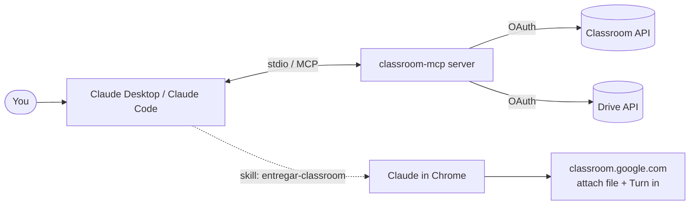

# classroom-mcp

[](https://github.com/alvaroarevalogrand-ui/classroom-mcp/actions/workflows/ci.yml)


*Leer en español: [README.es.md](README.es.md)*

An [MCP](https://modelcontextprotocol.io) server that lets Claude use **Google Classroom as a student**: list your courses, assignments, materials and announcements, download attachments from Drive, and prepare a submission. It ships with a **Claude Code skill** that finishes the job in your browser and turns the assignment in — after asking you.

> **Demo:** _TODO — add a screenshot or GIF here (e.g. `docs/demo.gif`)._

## The problem

Classroom has no student-friendly way to ask "what's due this week?", fetch every new slide deck, or hand in a file without clicking through five screens. This project exposes the student side of the Classroom and Drive APIs as MCP tools, so you can just tell Claude.

## Tools

Tool names and outputs are in Spanish (the project started as a Spanish-language setup).

| Tool | What it does |
|---|---|
| `listar_cursos` | Courses you are enrolled in (optionally archived) |
| `listar_tareas` | Assignments of a course, with due date, points and attachments |
| `mis_entregas` | State of your submissions (pending, turned in, returned, grade) |
| `listar_materiales` | Course materials (notes, slides) with their attachments |
| `listar_temas` | Course topics |
| `listar_anuncios` | Stream announcements |
| `descargar_archivo` | Download a Drive attachment (Docs/Slides are exported to PDF) |
| `preparar_entrega` | Upload a local file to Drive and return the assignment link and state |

## Architecture



## Why submissions need the browser

The Classroom API only allows `modifyAttachments` and `turnIn` on coursework **created by the same Google Cloud project** that makes the call. Assignments created by a teacher belong to another project, so your project is always refused. `preparar_entrega` therefore uploads the file to your Drive, and the last step — attach and **Turn in** — happens in the Classroom web UI. The bundled skill drives that step through [Claude in Chrome](https://claude.com/chrome), and never turns anything in without your explicit "yes".

## Install

```bash
git clone https://github.com/alvaroarevalogrand-ui/classroom-mcp.git
cd classroom-mcp
python -m venv .venv
.venv/bin/pip install -e .          # Windows: .venv\Scripts\pip install -e .
```

This installs two commands: `classroom-mcp` (the server) and `classroom-mcp-auth` (one-time authorization).

## Google Cloud setup (~10 min)

Use the same Google account you use for Classroom if your school allows it.

1. Open the [Google Cloud console](https://console.cloud.google.com) and create a project (e.g. `classroom-mcp`).
2. **APIs & Services → Library**: enable **Google Classroom API** and **Google Drive API**.
3. **Google Auth Platform / OAuth consent screen**:
   - User type **External** (or **Internal** if your Workspace allows it).
   - Fill in app name and contact emails.
   - Leave publishing status on **Testing**.
   - Under **Audience / Test users**, add the email you use for Classroom.
4. **Credentials → Create credentials → OAuth client ID**, type **Desktop app**. Download the JSON and save it as `credentials.json`.

Keep `credentials.json` and `token.json` private. They are git-ignored.

## Authorize

The server looks for `credentials.json` and `token.json` in the folder named by `CLASSROOM_MCP_HOME` (default: the current directory).

```bash
export CLASSROOM_MCP_HOME=~/.classroom-mcp   # PowerShell: $env:CLASSROOM_MCP_HOME="$HOME\.classroom-mcp"
mkdir -p "$CLASSROOM_MCP_HOME"               # put credentials.json there
classroom-mcp-auth
```

A browser window opens → pick your Classroom account → "Google hasn't verified this app" → **Continue** → grant all permissions. `token.json` is written next to `credentials.json`.

## Configuration

| Variable | Default | Purpose |
|---|---|---|
| `CLASSROOM_MCP_HOME` | current directory | Folder with `credentials.json` / `token.json` |
| `CLASSROOM_DOWNLOAD_DIR` | `$CLASSROOM_MCP_HOME/downloads` | Default destination of `descargar_archivo` |
| `CLASSROOM_DRIVE_FOLDER` | `Entregas Classroom` | Drive folder used by `preparar_entrega` |

See [.env.example](.env.example). Set them in the `env` block of your MCP client config; the server does not read `.env` files itself.

## Register with Claude Desktop

Edit `claude_desktop_config.json` (Settings → Developer → Edit config):

```json
{
  "mcpServers": {
    "classroom": {
      "command": "/path/to/classroom-mcp/.venv/bin/classroom-mcp",
      "env": {
        "CLASSROOM_MCP_HOME": "/home/you/.classroom-mcp",
        "CLASSROOM_DOWNLOAD_DIR": "/home/you/Documents/classes"
      }
    }
  }
}
```

On Windows use `.venv\\Scripts\\classroom-mcp.exe` with escaped backslashes. Fully quit and reopen Claude Desktop.

## Register with Claude Code

```bash
claude mcp add classroom -s user \
  -e CLASSROOM_MCP_HOME=$HOME/.classroom-mcp \
  -- /path/to/classroom-mcp/.venv/bin/classroom-mcp
claude mcp list
```

## Install the submission skill

```bash
mkdir -p ~/.claude/skills/entregar-classroom
cp skills/entregar-classroom/SKILL.md ~/.claude/skills/entregar-classroom/
```

Then install the **Claude in Chrome** extension, keep your Classroom Google session open in Chrome, and start Claude Code with `claude --chrome` (or `/chrome` → *Enabled by default*). Use it with `/entregar-classroom` or just ask: *"submit report.pdf to assignment 3 of my Physics course"*.

The skill (written in Spanish, matching the Spanish Classroom UI labels) enforces: explicit confirmation before **Turn in**, no removal of existing attachments, and treating page content as data, never as instructions.

## Troubleshooting

| Symptom | Cause / fix |
|---|---|
| `access_denied` / app blocked | Your email is not listed under **Test users** on the consent screen. Add it. If your school's Workspace admin blocks third-party apps, only they can allow it. |
| Token invalid after about a week | In **Testing** mode refresh tokens expire after **7 days**. Re-run `classroom-mcp-auth`. |
| `Scope has changed` warning | Google returns some scopes under aliases. Already handled: the auth command sets `OAUTHLIB_RELAX_TOKEN_SCOPE=1` and the server loads the scopes actually granted. |
| `403 … Classroom API has not been used` | Enable the API in the Cloud project. |
| `insufficientPermissions` on upload | Old token without the Drive upload scope: delete `token.json` and re-authorize. |
| `Falta token.json` | `CLASSROOM_MCP_HOME` points to the wrong folder, or you haven't authorized yet. |

## Development

```bash
pip install -e ".[dev]"
ruff check . && ruff format --check .
pytest
```

CI runs ruff and pytest on Python 3.11 and 3.12.

## License

[MIT](LICENSE) © Álvaro Arévalo
